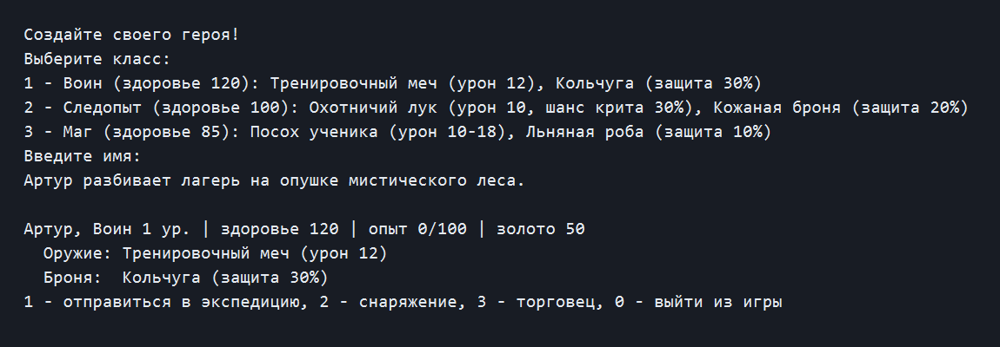
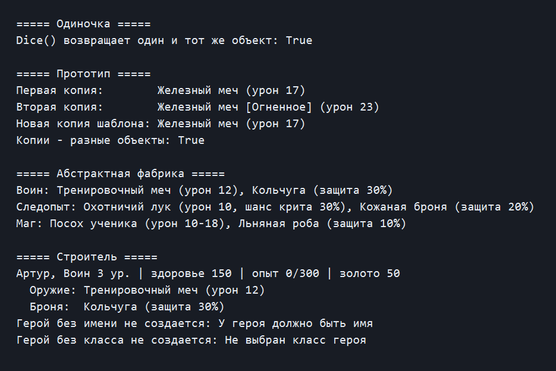
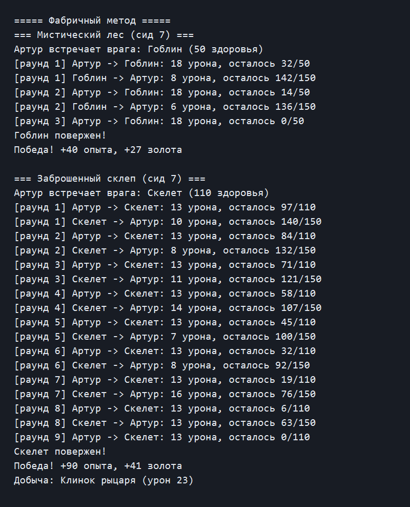

# Лабораторная работа №3

**Тема:** порождающие шаблоны проектирования.

**Цель работы:** изучить паттерны Singleton, Builder, Factory Method,
Abstract Factory и Prototype и применить их в текстовой RPG.

## Описание игры

Игрок создаёт героя, выбирает имя и класс: воин, следопыт или маг.
Каждый класс получает своё начальное оружие и броню.
Герой находится в лагере, откуда отправляется в экспедиции.
Цель игры — усилить героя и победить дракона.

В игре доступны:

- три локации: мистический лес, заброшенный склеп и логово дракона;
- пошаговые автоматические бои с гоблином, скелетом и драконом;
- получение опыта, повышение уровня и награды золотом;
- добыча предметов, зачарования и смена экипировки;
- покупка и продажа предметов у торговца.

Перед экспедицией здоровье восстанавливается. При поражении герой теряет
половину золота и может продолжить игру.

## Запуск

Запуск игры:

```sh
python -m labs.lab3.main
```

Демонстрация пяти паттернов без ввода с клавиатуры:

```sh
python -m labs.lab3.demo
```

## Реализованные паттерны

| Паттерн | Где реализован | Как используется и демонстрируется |
| --- | --- | --- |
| Одиночка (Singleton) | `dice.py` | Все случайные события используют один экземпляр `Dice`. Два вызова `Dice()` сравниваются через `is`: результат `True`. |
| Строитель (Builder) | `hero.py` | `Hero.Builder` пошагово задаёт имя, класс, снаряжение и уровень. В консоль выводится созданный герой. |
| Фабричный метод (Factory Method) | `world.py` | Подклассы локаций переопределяют `_create_enemy()`. Демонстрация показывает гоблина из леса и скелета из склепа. |
| Абстрактная фабрика (Abstract Factory) | `kits.py` | Фабрики воина, следопыта и мага создают семейства из двух предметов методами `create_weapon()` и `create_armor()`. Все три набора выводятся в консоль. |
| Прототип (Prototype) | `items.py` | Предметы создаются копированием образцов каталога. Зачарование одной копии меча не изменяет другую копию и шаблон. |

## Структура проекта

Связанные классы объединены в модули без вложенных пакетов:

| Файл | Содержимое |
| --- | --- |
| `dice.py` | Единый генератор случайности и ошибка неизвестного кода |
| `combat.py` | Боевая механика, события и отчёты |
| `items.py` | Оружие, броня, зачарования и каталог прототипов |
| `kits.py` | Классы героя и фабрики стартового снаряжения |
| `hero.py` | Герой и его строитель |
| `enemies.py` | Гоблин, скелет, дракон и их общая логика |
| `world.py` | Локации, экспедиции, награды и торговец |
| `main.py` | Игровое меню и вывод в консоль |
| `demo.py` | Демонстрация пяти паттернов |

`__init__.py` обозначает пакет лабораторной, а `images/` хранит изображения
для этого README.

## Результаты работы

Ниже приведены изображения фактического вывода программы, оформленные
для чтения в README.

### Создание героя и лагерь

После выбора класса и имени выводятся характеристики героя, начальное
снаряжение и основное меню.



### Демонстрация паттернов

Видны единственность игральной кости, независимость копий меча,
различия трёх семейств снаряжения и результат работы строителя.



### Фабричный метод и бои

Лес и склеп создают разных противников. Отчёт показывает здоровье врага,
ход боя по раундам и полученные награды. Сид позволяет повторить случайные
события при одинаковом исходном состоянии героя.



## Вывод

В работе реализована текстовая RPG с пятью порождающими паттернами.
Создание героя, врагов, комплектов снаряжения и копий предметов разделено
между соответствующими классами. Использование каждого паттерна
демонстрируется выводом в консоль.

## Задание

- [Условия лабораторной работы](https://github.com/tidbid-kt/tech-prog-2026/blob/main/labs/laba3/laba3.md).
- [Практика на Python](https://github.com/tidbid-kt/tech-prog-2026/blob/main/labs/laba3/practice/python.md).
