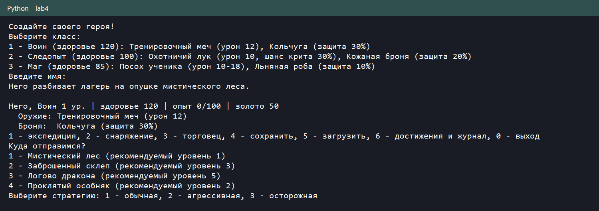
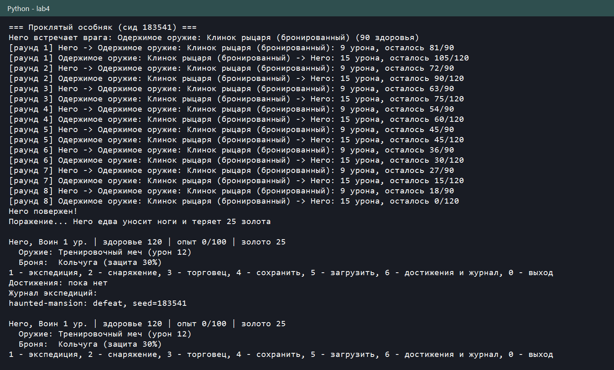
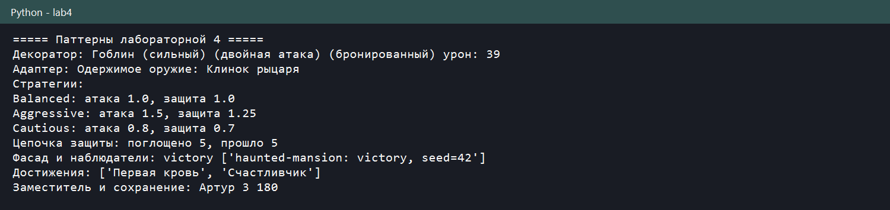

# Лабораторная работа №4

**Тема:** структурные и поведенческие шаблоны проектирования.

**Цель:** изучить семь паттернов и применить их при развитии текстовой RPG из лабораторной №3. Игра скопирована в отдельный пакет, поэтому версия третьей работы остаётся самостоятельной.

## Запуск

Из корня репозитория, с Python 3.10 или новее:

```sh
python -m labs.lab4.main
```

Демонстрация паттернов без ввода:

```sh
python -m labs.lab4.demo
```

Сторонние библиотеки не требуются.

## Возможности

В игре доступны три класса героя, торговец, снаряжение и четыре локации, включая проклятый особняк с одержимым оружием. Перед экспедицией можно выбрать обычную, агрессивную или осторожную стратегию. Враги получают случайные сочетания усилений.

В лагере можно посмотреть достижения и журнал, сохранить героя в `save.json` и загрузить его обратно. Сохранение включает опыт, золото, экипировку с зачарованиями, инвентарь и достижения. Журнал хранится в памяти текущего запуска.

## Реализованные паттерны

| Паттерн | Реализация в `patterns.py` |
| --- | --- |
| Декоратор | `StrongEnemy`, `ArmoredEnemy`, `DoubleAttackEnemy` комбинируют усиления врага. |
| Заместитель | `CachedSave` кэширует сохранение и возвращает независимые копии героя. |
| Адаптер | `PossessedWeapon` позволяет оружию выступать в роли врага. |
| Фасад | `GameFacade` объединяет экспедицию, оповещение наблюдателей и сохранение. |
| Стратегия | `Balanced`, `Aggressive`, `Cautious` меняют соотношение атаки и защиты. |
| Наблюдатель | `AchievementObserver` и `JournalObserver` реагируют на завершение экспедиции. |
| Цепочка обязанностей | `Dodge` и `Shield` последовательно обрабатывают входящий урон. |

Цепочка защиты применяется к герою, а щит — к бронированному врагу. В демонстрации сохранение записывается во временный каталог и не затрагивает игровое.

## Результаты работы

Изображения подготовлены по фактическому выводу программы.

### Создание героя и выбор экспедиции



### Экспедиция в проклятый особняк



### Демонстрация паттернов



## Вывод

Структурные и поведенческие паттерны позволили расширить игру новыми противниками, тактиками, сохранением и системой прогресса.

Условия работы: [лабораторная №4](https://github.com/tidbid-kt/tech-prog-2026/blob/main/labs/laba4/laba4.md), [практика на Python](https://github.com/tidbid-kt/tech-prog-2026/blob/main/labs/laba4/practice/python.md).
