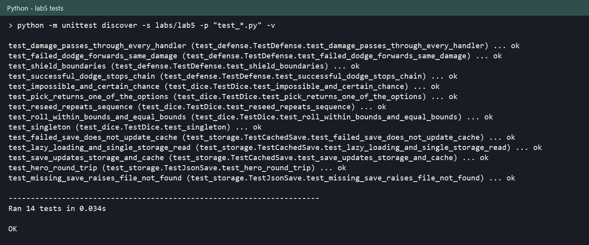

# Лабораторная работа №5

**Тема:** автоматизированное тестирование программного обеспечения.

**Цель:** проверить код игры из лабораторной №4 модульными и интеграционными тестами, в том числе с подменой зависимостей.

## Запуск

Из корня проекта:

```sh
python -m unittest discover -s labs/lab5 -p "test_*.py" -v
```

Используется встроенный модуль `unittest` и `unittest.mock`, поэтому устанавливать сторонние библиотеки не требуется. В методичке показан `pytest`; здесь те же подходы реализованы средствами стандартной библиотеки. Тесты проверяют код из `labs/lab4`, а не копию игры.

## Что проверяется

| Тестовый класс | Объект проверки | Сценарии |
| --- | --- | --- |
| `TestDice` | Порождающий паттерн Singleton | Один экземпляр кубика, диапазон значений, крайние вероятности, выбор элемента, повторяемость с seed. |
| `TestDefense` | Поведенческий паттерн «Цепочка обязанностей» | Границы защиты, прохождение через несколько обработчиков, успешное и неудачное уклонение. |
| `TestCachedSave` | Структурный паттерн Proxy | Отложенное чтение, повторное чтение из кэша, сохранение и ошибка хранилища. |
| `TestJsonSave` | Интеграция с файловой системой | Сохранение и восстановление характеристик, зачарований, инвентаря и достижений; отсутствие файла. |

В тестах уклонения случайный кубик и следующий обработчик заменены моками: это позволяет проверить оба исхода и передачу управления. В тестах кэша мок хранилища показывает число обращений к нему. Проверяемые обработчик и кэш остаются настоящими объектами. Граничные значения щита проверяются с помощью `subTest`.

Интеграционный тест работает с настоящим JSON-файлом во временном каталоге и не изменяет игровое сохранение. Тесты расположены отдельно, но используют классы четвёртой лабораторной напрямую.

## Результат запуска

Все 14 тестов прошли. Изображение подготовлено по фактическому выводу команды:



## Вывод

Модульные тесты проверяют отдельные правила и взаимодействие с подменёнными зависимостями, а интеграционный тест — совместную работу сохранения, JSON и файловой системы. Все проверки запускаются одной командой.

Условия работы: [лабораторная №5](https://github.com/tidbid-kt/tech-prog-2026/blob/main/labs/laba5/laba5.md), [практика на Python](https://github.com/tidbid-kt/tech-prog-2026/blob/main/labs/laba5/practice/python.md).
