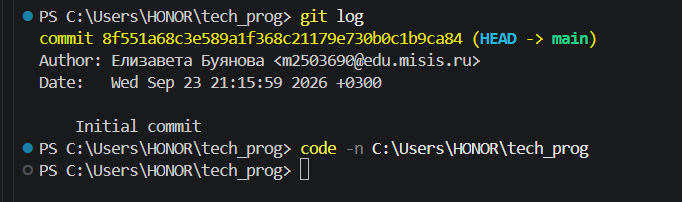
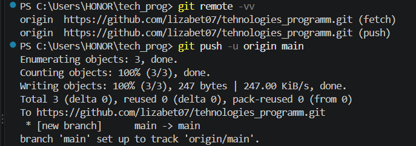
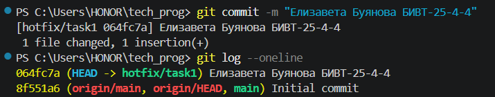
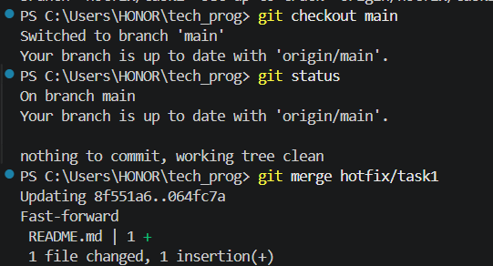
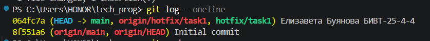
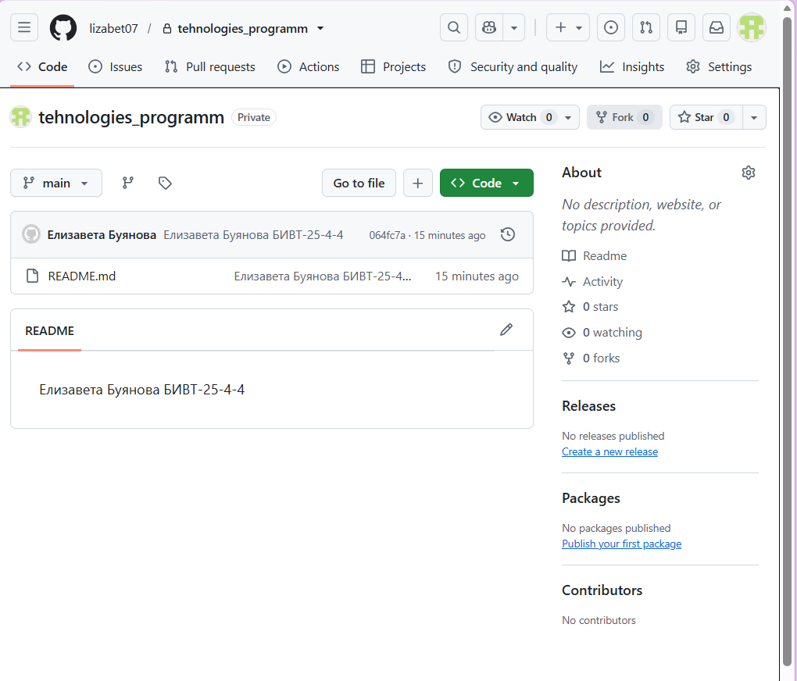

# Технологии программирования

## Лабораторная работа №1. Основы Git

### Ход работы

1. Создан локальный Git-репозиторий и выполнен первый коммит `Initial commit`.

2. Локальный репозиторий подключён к GitHub. Ветка `main` отправлена в удалённый репозиторий.

3. Создана ветка `hotfix/task1`. В `README.md` добавлены ФИО и группа, после чего выполнен второй коммит.

4. Ветка `hotfix/task1` объединена с веткой `main`.

5. Проверено итоговое состояние репозитория и история коммитов.

### Результат

Получен Git-репозиторий с двумя ветками — `main` и `hotfix/task1` — и двумя коммитами. Изменения успешно отправлены на GitHub.

