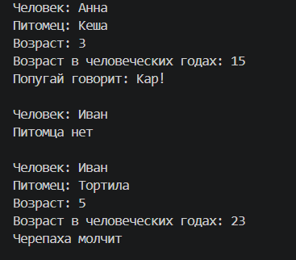

# Лабораторная работа №2

## Тема
Основы объектно-ориентированного программирования.

## Цель работы
Изучить основные принципы ООП: абстракцию, инкапсуляцию, наследование и полиморфизм.

## Структура и запуск

Каждый класс вынесен в отдельный модуль: `pet.py`, `animal.py`,
`parrot.py`, `turtle.py`, `person.py`. В `main.py` находится демонстрация.

Из корня проекта программу можно запустить командой:

```sh
python labs/lab_02/main.py
```

В `Animal` используются приватные поля `__name` и `__age`,
в `Person` — `__name` и `__pet`. Двойное подчёркивание включает
механизм name mangling: защиту от случайного прямого доступа,
а не абсолютный запрет доступа к данным.
Чтение выполняется через `get_name()`, `get_age()` и `get_pet()`,
изменение — через `happy_birthday()` и `set_pet()`.
Наследники получают возраст через `get_age()`.
Метод `express()` возвращает ASCII-рисунок и поведение животного.

## Ход работы

В программе был создан абстрактный класс `Pet`, который задаёт основные методы для питомцев:

- получение имени;
- получение возраста;
- вывод поведения питомца;
- расчёт возраста в человеческих годах.

После этого был создан класс `Animal`, который наследуется от `Pet`.

В классе `Animal` находятся общие данные для всех животных:
- имя;
- возраст.

На основе класса `Animal` были созданы два отдельных класса:

- `Parrot`
- `Turtle`

Для каждого класса по-разному реализованы методы поведения и расчёта возраста в человеческих годах.

Для попугая человеческий возраст рассчитывается как возраст животного, умноженный на 5.

Для черепахи первый год считается как 15 человеческих лет, а каждый следующий год добавляет ещё 2 года.

Также был создан класс `Person`.

У человека есть:
- имя;
- питомец.

Питомец может быть задан сразу при создании человека или добавлен позже.

В основной части программы были созданы два человека.

У первого человека сразу есть попугай.

У второго человека сначала питомца нет, затем ему добавляется черепаха.

После этого программа выводит информацию о человеке и его питомце.

## Результат работы программы

Программа корректно создаёт объекты людей и животных, выводит информацию о питомцах и рассчитывает их возраст в человеческих годах.

Ранее сохранённый скриншот, до добавления ASCII-рисунков:



